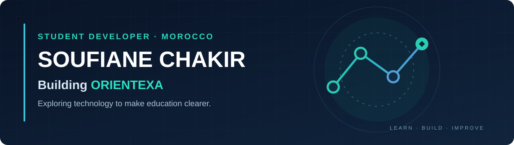

<!-- Welcome to my GitHub profile -->

  

<h3 align="center">Hello! I'm Soufiane 👋</h3>

  <strong>2 BAC Sciences Mathématiques</strong> · Student Developer · Morocco 🇲🇦

  Interested in web development, mathematics and building useful tools for students.

---

### 🚀 Current project: ORIENTEXA

**ORIENTEXA** is an educational orientation platform in development, designed to help Moroccan students explore post-baccalaureate possibilities and make more informed choices.

**What the project focuses on:**
- 🎓 Discovering schools, programs and academic pathways.
- 🧭 Exploring personalized orientation recommendations.
- ⚖️ Comparing different study options.
- 🛠️ Making complex orientation information easier to understand.

> **Project status:** Active development · Source repository private · Not publicly launched.

### 🛠️ Technologies I'm working with

  
  
  
  
  

### 🎯 What I'm focusing on

- Improving the ORIENTEXA user experience and visual design.
- Learning through practical web-development projects.
- Building accessible and useful experiences for Moroccan students.

---

  <em>Learning, building, and improving — one step at a time.</em>

<!-- Add ORIENTEXA's official website and professional contact links here only after they are ready. -->
